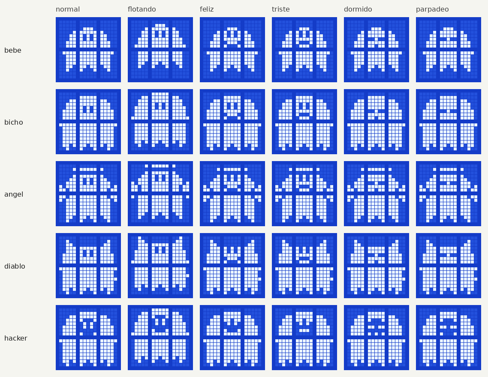

# Tamagotchi: Compañero de escritorio

Taller de **PawnGuard Cybersecurity Club**. En 3 horas armas y programas una
mascota virtual que vive en una **ESP32-C3 SuperMini** con pantalla OLED, tres
botones y un piezo. Todo va conectado por USB y el kit es tuyo.

El bichito es un fantasmita de sábana que nace de un huevo, tiene hambre, se
aburre, se cansa, hace caca, se enferma y, si lo descuidas, se muere. Según
cómo lo críes, de adulto se vuelve **bicho**, **ángel**, **diablo** o
**hacker**. Puedes jugar Pong con él y retar a los bichitos de tus compañeros
a piedra, papel o tijera **por radio**, con un protocolo que impide hacer
trampa.



**La guía completa del taller está en [TUTORIAL.md](TUTORIAL.md).**

---

## Qué necesitas

- Tu laptop (Windows, macOS o Linux) con su cargador.
- Un cable **USB-C de datos**. Para saber si sirve: conecta tu celular a la
  laptop con ese cable; si puedes pasar archivos, sirve. Los cables que solo
  cargan prenden la placa, pero la computadora no la ve.
- [Thonny](https://thonny.org) instalado.
- El kit del taller: ESP32-C3 SuperMini (ya trae MicroPython), OLED 0.96"
  128×64, protoboard de 170 puntos, 3 botones, piezo y cables.

## Descargar este repositorio

Botón verde **Code → Download ZIP** y descomprímelo, o con git:

```bash
git clone https://github.com/PawnGuard/tamagotchi-taller.git
```

## Conectar Thonny a la placa

1. Conecta la placa por USB.
2. En Thonny: **Herramientas → Opciones → Intérprete** (*Tools → Options →
   Interpreter*).
3. Elige **MicroPython (ESP32)** y el puerto de la placa:
   - Windows: `COM3`, `COM4`…
   - macOS: `/dev/cu.usbmodem…`
   - Linux: `/dev/ttyACM0`
4. Abajo, en la consola, debe salir `>>>`. Si no, aprieta el botón rojo
   **Stop**.

En Linux, si dice que no tienes permiso para el puerto:
`sudo usermod -aG dialout $USER` y cierra sesión.

¿Prefieres VS Code? Sigue [VSCODE.md](VSCODE.md) en lugar de esta sección y la
siguiente.

## Subir el código

1. Abre **Ver → Archivos** (*View → Files*).
2. Arriba (tu computadora) entra a la carpeta `src` de este repositorio.
3. Selecciona todos los `.py` y la carpeta `apartados`, clic derecho →
   **Subir a /** (*Upload to /*).
4. Cada vez que cambies un archivo, vuelve a subir ese archivo.

## Probar y jugar

- **Autodiagnóstico:** abre `src/prueba.py` y dale **Ejecutar** (F5). La
  pantalla dice "HOLA", el piezo toca una escala y te pide cada botón.
- **Jugar:** abre `src/tama.py` y dale **Ejecutar** (F5). Para pararlo,
  **Stop** (Ctrl+F2).
- **Que arranque solo al conectarlo:** sube `autoarranque/main.py` a `/`. Para
  volver a programar, borra `main.py` de la placa (clic derecho → Borrar).
- **Huevo nuevo:** borra `bicho.json` de la placa.

| Dónde | A | B | C |
|---|---|---|---|
| Casa | abre el menú | — | — |
| Menú | siguiente opción | elegir | volver a casa |
| Dentro de una opción | depende | depende | casi siempre sale |
| Muerto | — | otro huevo | — |

Menú: `COMER`, `LIMPIAR`, `CURAR`, `JUGAR`, `AMIGOS`, `SALUDAR`, la opción sin
nombre (ejercicio 2), `VIDEO`, `LUZ`, `ESTADO` e `INTRO`.

## Cableado

| Función | GPIO |
|---|---|
| OLED SDA | 3 |
| OLED SCL | 4 |
| Botón A | 0 |
| Botón B | 1 |
| Botón C | 10 |
| Piezo | 7 |

La OLED se enchufa directo sobre la placa y la imagen se voltea por software.
El diagrama paso a paso está en
[docs/cableado_protoboard170.md](docs/cableado_protoboard170.md). Si cambias
algo de lugar, los pines viven en `src/config.py`.

## Tu propio video

El apartado `VIDEO` reproduce un video tuyo convertido a 128×64 en blanco y
negro. Necesitas Python con `opencv-python` y `numpy`:

```bash
pip install opencv-python numpy
python3 herramientas/video_a_oled.py mi_video.mp4 --inicio 2 --segundos 8
```

Se guarda en `src/apartados/video_cuadros.bin`; súbelo a `/apartados` en la
placa. Usa solo videos que sean tuyos o que tengas permiso de usar. Este
repositorio no incluye ningún video.

---

## Estructura

```
src/                 el código que va a la placa
├── tama.py          punto de entrada: prende el hardware y corre el bucle
├── config.py        pines, escala de tiempo, radio
├── bicho.py         el modelo: necesidades, etapas de vida y crianza
├── juego.py         las pantallas (CASA, MENU, APARTADO) y los botones
├── menu.py          qué opciones tiene el menú y en qué orden
├── apartados/       una opción del menú = un archivo
│   ├── saludar.py   EJERCICIO 1
│   ├── sin_nombre.py EJERCICIO 2
│   └── ...
├── dibujo.py        atajos para dibujar
├── sprites.py       los dibujos, hechos con texto ('#' y '.')
├── duelo.py         duelos por radio con commit-reveal
├── pantalla.py  botones.py  sonido.py  radio.py  memoria.py
└── prueba.py        autodiagnóstico del hardware

tests/               pruebas en la PC, sin placa
herramientas/        convertir un video, subir el código y flashear sin Thonny
autoarranque/        main.py para que arranque solo
docs/                cableado
subir.sh, flashear.sh  scripts para el staff (Linux/macOS, con mpremote)
.vscode/             tareas para quien use VS Code (ver VSCODE.md)
```

## Pruebas en la PC

La lógica (`bicho.py`, `juego.py`, `duelo.py` y los apartados) no toca el
hardware, así que se prueba en la computadora sin placa:

```bash
python3 -m unittest discover -s tests
```

## Para el staff: preparar placas nuevas

Las placas vienen **sin firmware**. Con `esptool` y `mpremote`
(`python -m pip install -r requirements.txt`), este script descarga
MicroPython v1.29.0, comprueba que el archivo sea el oficial, lo graba y sube
el proyecto. Funciona en Windows, macOS y Linux:

```bash
python herramientas/flashear.py
```

En Linux y macOS también está `./flashear.sh`, que hace lo mismo.

Después, para volver a subir el código: `./subir.sh`.

---

## Licencia

[MIT](LICENSE). Hecho por PawnGuard Cybersecurity Club.

"Tamagotchi" es marca registrada de Bandai. Este es un proyecto educativo sin
relación con Bandai.
