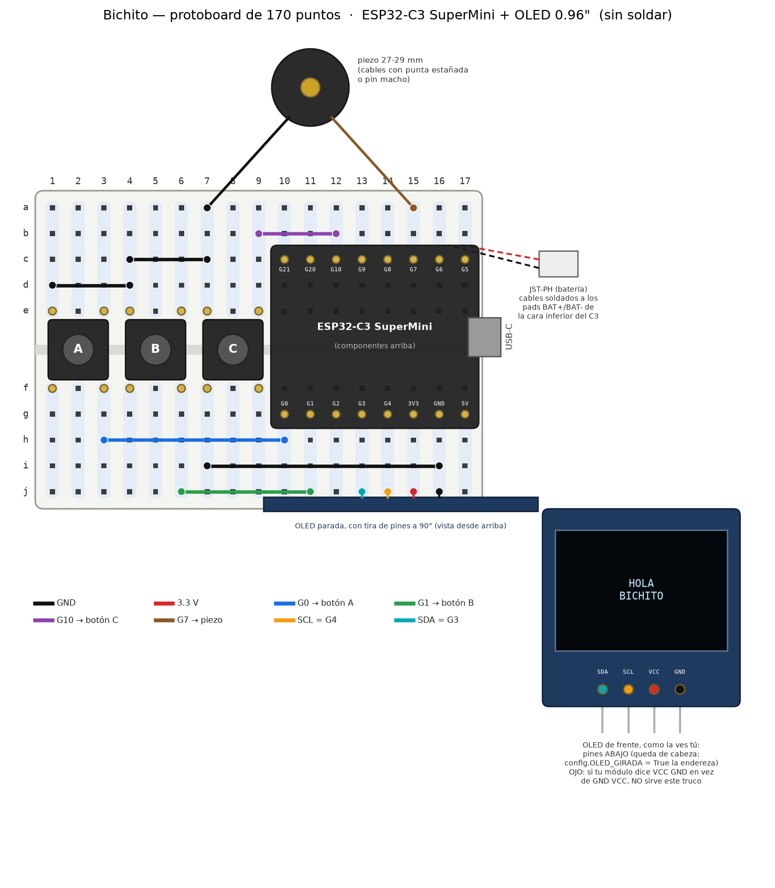

# Cableado del Bichito en protoboard de 170 puntos (sin soldar)

Protoboard mini de 17 columnas × 10 filas (`a–e` | canal | `f–j`), 48.5 × 35 mm, sin rieles de
alimentación. Cada columna une sus 5 agujeros `a–e` y, por separado, sus 5 agujeros `f–j`.
El único punto con soldadura es la batería (cables a los pads del C3).



Regenerar la imagen: `python3 docs/generar_cableado_protoboard170.py` (desde `docs/`).

## Idea del diseño

- La **SuperMini** va a horcajadas del canal, en las columnas 10–17, con los pines en las filas
  `c` y `g` y el USB-C asomando por la derecha. A cada pin le quedan 2 agujeros libres arriba
  (`a, b`) y 3 abajo (`h, i, j`).
- **La OLED se enchufa directo, sin cables.** Sus pines, vistos de frente con la pantalla de
  cabeza, son `SDA SCL VCC GND`. En la fila `j`, columnas 13–16, caen sobre **G3, G4, 3V3 y
  GND** del C3. Por eso en esta placa `SDA = G3` y `SCL = G4`, y el software voltea la imagen
  (`OLED_GIRADA = True`). La pantalla queda parada al frente, mirando hacia ti.
  **Para que quede parada, la OLED necesita una tira de pines a 90°** (en ángulo recto).
  Con los pines rectos que traen casi todos los módulos se acuesta, y entonces el orden de
  los pines ya no coincide. Se puede cambiar la tira o doblar los 4 pines a 90° con pinzas.
- Los **botones** también van a horcajadas del canal (patas en `e` y `f`). Las dos patas de una
  misma columna están unidas por dentro, así que cada botón **une la tira de arriba con la de
  abajo**. Así GND pasa de la mitad inferior a la superior sin cables extra.
- **6 cables, ninguno cruzado.**

## Conexiones

| # | Red | De | A | Para qué |
|---|---|---|---|---|
| 1 | G0 | h10 | h3 | botón A |
| 2 | G1 | j11 | j6 | botón B |
| 3 | G10 | b12 | b9 | botón C |
| 4 | GND | i16 | i7 | GND del C3 a la pata izquierda de C |
| 5 | GND | c7 | c4 | … a la pata izquierda de B |
| 6 | GND | d4 | d1 | … a la pata izquierda de A |
| — | G7 | a15 | piezo (rojo) | sonido |
| — | GND | a7 | piezo (negro) | sonido |
| — | OLED | j13 j14 j15 j16 | SDA SCL VCC GND | directo, sin cables |

Botones: A en las columnas 1 y 3, B en 4 y 6, C en 7 y 9. En los tres, la pata izquierda va a
GND y la derecha al GPIO.

## Software

En `src/config.py`, para esta placa:

```python
PIN_SDA, PIN_SCL = 3, 4
OLED_GIRADA = True
BOTONES = (("a", 0), ("b", 1), ("c", 10))
PIN_PIEZO = 7
```

## Antes de enchufar: errores típicos

1. **Tira de la OLED a 90°.** Si tu módulo trae los pines rectos, cámbiala o dóblalos
   (ver arriba). Si no, la pantalla no queda parada.
2. **Pines de la OLED.** Lee la serigrafía de tu módulo. Este truco solo funciona si, con los
   pines arriba y la pantalla hacia ti, el orden es `GND VCC SCL SDA`. Algunos módulos traen
   `VCC GND SCL SDA`: con esos, la OLED recibiría la alimentación al revés. En ese caso,
   conéctala con 4 cables.
3. **Botón girado 90°.** Si una pata queda en la misma fila que su vecina, el botón está
   "siempre apretado". Las patas deben quedar en `e` y `f`, a ambos lados del canal.
4. **Separación de las filas del C3.** El diseño supone 6 agujeros (0.6") entre las dos filas
   de pines (`c` y `g`). Presenta la placa sin empujar antes de montarla.
5. **Comprobar los botones con el multímetro** (sin USB). Pata derecha ↔ pin G del C3: no debe
   pitar sin apretar y sí debe pitar al apretar.
6. **Piezo:** los cables de los discos son delgados y multifilares. Estáñalos o crimpa un pin
   macho para que no se suelten de la protoboard.

## Limitaciones

- Al mover el bichito, los cables y botones se pueden aflojar. Funciona mejor como mascota de
  escritorio que como llavero de bolsillo.
- Pegar la protoboard (trae adhesivo) a una base o carcasa ayuda a que no se desarme.
